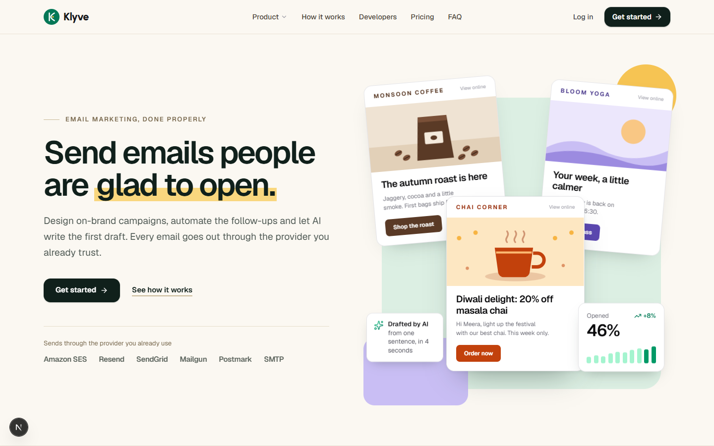
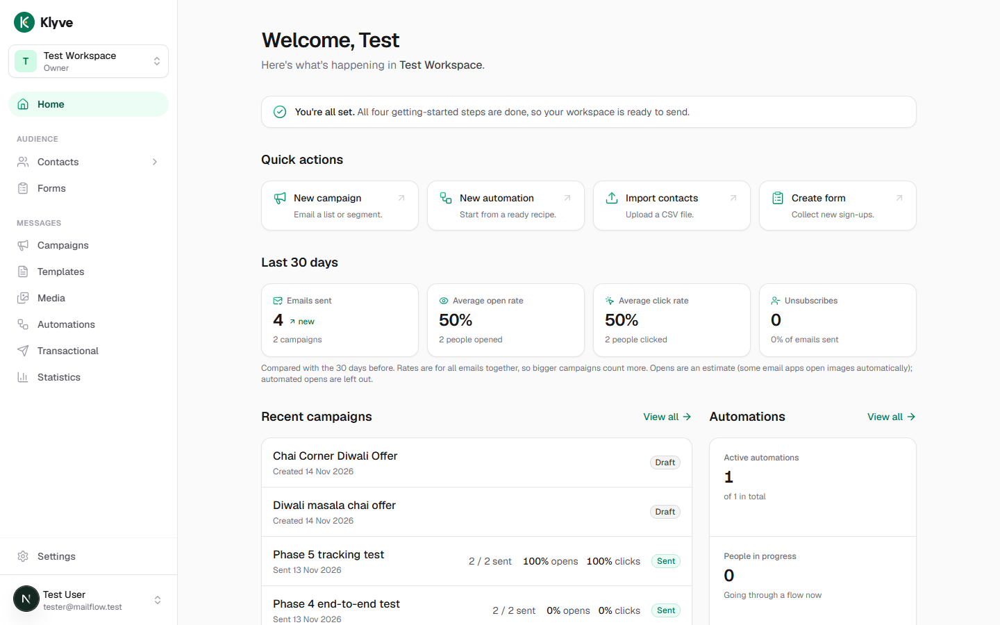
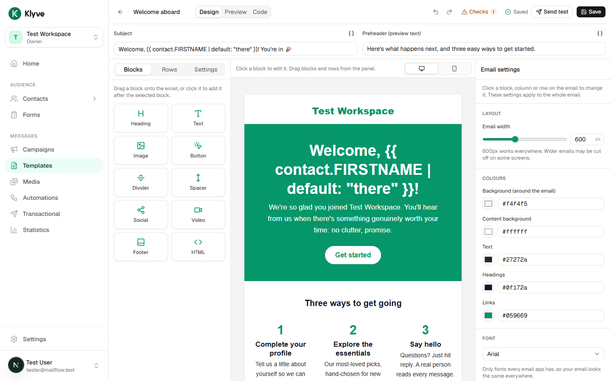
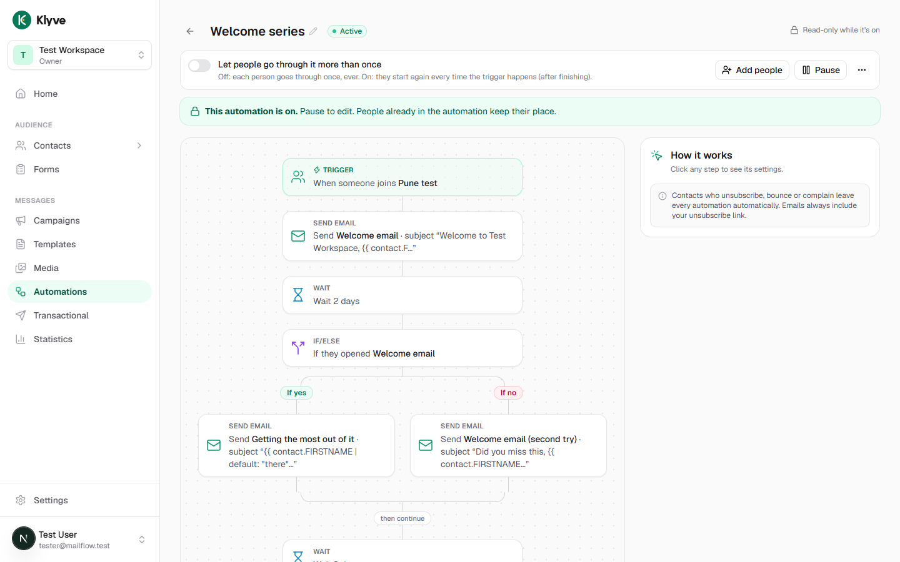

<div align="center">

# Klyve

**Free, open-source email marketing that sends through your own provider.**

Campaigns, automations, sign-up forms, a transactional email API and AI writing help,
delivered through Amazon SES, Resend, SendGrid, Mailgun, Postmark or any SMTP server you choose.

[**Live app → klyveapp.tech**](https://klyveapp.tech) &nbsp;·&nbsp; [API docs](https://klyveapp.tech/docs/api) &nbsp;·&nbsp; [License: AGPL-3.0](LICENSE)



</div>

## Why Klyve

Most email marketing tools charge per contact or per email, because they send everything through
their own servers. Klyve doesn't. You connect **your own sending provider**, so you pay that
provider's price (often a few cents per thousand emails), and Klyve gives you the tools around it,
for free.

- **Hosted and free:** sign up at [klyveapp.tech](https://klyveapp.tech) without installing anything.
- **Or self-host it:** it's one Next.js app and one PostgreSQL database.
- **Bring your own provider:** Amazon SES, Resend, SendGrid, Mailgun, Postmark or SMTP, per workspace.
  Your API keys and passwords are stored encrypted (AES-256-GCM).

## Features

| | |
|---|---|
| **Contacts** | Lists, segments, custom fields, CSV import, suppression list, double opt-in, consent records |
| **Campaigns** | Drag-and-drop email editor, starter templates, scheduling, folders, test sends, open and click tracking, UTM tags |
| **Automations** | Visual flows with triggers, waits, if/else branches and emails (welcome series, birthdays, follow-ups) |
| **Sign-up forms** | Hosted form pages and embeddable forms that feed your lists |
| **Transactional API** | REST API with API keys for receipts, password resets and other one-to-one emails ([docs](https://klyveapp.tech/docs/api)) |
| **AI writing help** | Draft campaigns, subject line ideas, rewrite text, build segments and explain reports (powered by Groq) |
| **Statistics** | Per-campaign and workspace reports, CSV export |
| **Deliverability** | Sending domain DNS checks (SPF, DKIM, DMARC), bounce and complaint webhooks, automatic pausing when bounce rates spike |
| **Teams** | Workspaces with owner, admin and member roles, email invites |
| **Accounts** | Email + password or Google sign-in, two-step login (authenticator app), session management, self-service account deletion |
| **Privacy** | Unsubscribe and preference centre, GDPR export and erasure for contacts |

<table>
  <tr>
    <td></td>
    <td></td>
  </tr>
  <tr>
    <td align="center">Dashboard</td>
    <td align="center">Drag-and-drop email editor</td>
  </tr>
  <tr>
    <td colspan="2"></td>
  </tr>
  <tr>
    <td colspan="2" align="center">Automation builder</td>
  </tr>
</table>

## Tech stack

- **App:** [Next.js 16](https://nextjs.org) (App Router, Server Actions, Partial Prerendering), React 19, TypeScript
- **UI:** Tailwind CSS 4, shadcn/ui (Base UI), lucide icons, dnd-kit for the editor
- **Data:** PostgreSQL 17 with [Prisma 7](https://www.prisma.io)
- **Auth:** [Better Auth](https://www.better-auth.com): email + password, Google OAuth, TOTP two-step login
- **Email:** Nodemailer and the providers' APIs (AWS SDK for SES); a background worker inside the app sends campaigns, automations and transactional email
- **AI:** Groq (OpenAI-compatible API) with per-workspace and per-user limits
- **Production:** one Ubuntu server on AWS EC2, Nginx + PM2 + Let's Encrypt, nightly database backups

## Run it locally

You need **Node.js 22** and **Docker** (for the local database and a fake inbox).

```bash
git clone https://github.com/SrushtiKhandelwal/klyve.git
cd klyve
docker compose up -d          # PostgreSQL on port 5433 + Mailpit (fake inbox) on http://localhost:8025
cp .env.example .env          # then fill in BETTER_AUTH_SECRET and ENCRYPTION_KEY (see the comments)
npm install
npx prisma migrate dev        # creates the database tables
npm run dev                   # http://localhost:3000
```

Emails sent while developing land in Mailpit at http://localhost:8025, so nothing is really delivered.
Optional settings (Google sign-in, AI writing help, Klyve's own system emails) are explained in
`.env.example`.

## Self-host in production

- [`docs/DEPLOY-EC2.md`](docs/DEPLOY-EC2.md): one Ubuntu server with Nginx, PM2 and PostgreSQL (how
  klyveapp.tech runs). Scripts are in [`deploy/ec2/`](deploy/ec2).
- [`docs/DEPLOY.md`](docs/DEPLOY.md): the Docker Compose + Caddy alternative.

## Contributing

Issues and pull requests are welcome. For anything bigger than a small fix, please open an issue
first so we can agree on the approach. Run `npm run lint` and `npm run build` before sending a pull request.

Found a security problem? Please don't open a public issue. Email the address on
[klyveapp.tech](https://klyveapp.tech) instead.

## License

Copyright © 2026 Srushti Khandelwal.

Klyve is free software under the [GNU Affero General Public License v3.0](LICENSE). You can use,
change and self-host it. If you run a modified version as a service for others, you must share your
changes under the same license.
